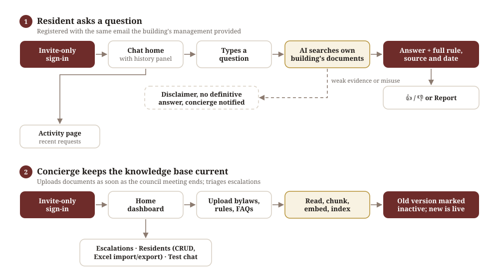
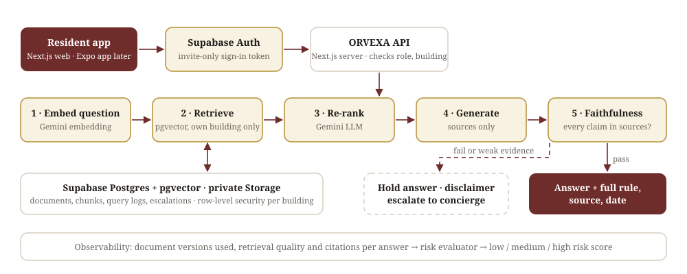

<h1 align="center">ORVEXA</h1>

An AI-powered coordination layer that helps residents of high-rise buildings instantly access and follow their building's bylaws and rules. Residents ask in plain English; ORVEXA answers from the building's own, up-to-date documents and shows the exact rule, its source and its date.

**Full PRD:** [ORVEXA-PRD.pdf](about-the-product/ORVEXA-PRD.pdf)

---

## 1. 🌟 Product vision

**An AI-native building operating system, powered by RAG, that gives residents accurate, up-to-date, building-specific bylaws and operational rules on demand.**

- Start with answers: residents retrieve rules from a continuously evolving knowledge base instead of waiting for management.
- Later phases: an agentic RAG layer that helps residents, building staff and property managers complete actions and resolve operational requests end-to-end, without a middleman and delays.

## 2. 🧩 The problem

- **For residents:** bylaws and operational policies change often, so they're hard to track and interpret consistently. Misunderstandings can lead to non-compliance, infractions or fines.
- **For building management:** teams handling high resident volume (e.g. 2,000+ residents across 50+ floors, especially in new buildings) face operational overload, response delays and backlogs.
- **The opportunity:** no application is in use today; residents email or message building management for every clarification.

## 3. 👥 Who it's for

| User | What they need |
|---|---|
| **Resident** | Clear, current answers on amenities, visitor parking, move-in, garbage timings and who to contact |
| **Concierge / Admin** | One place to upload documents, manage residents and handle escalations |
| **Property manager** | Later phases |

## 4. 💡 The solution

Planned flow (not built yet):

1. The concierge uploads bylaws, rules and FAQs as soon as the council meeting ends; the old version is marked inactive.
2. A resident signs in (invite-only, with the email their building's management has on file) and asks a question in a chat.
3. ORVEXA searches **only that resident's building's** current documents, re-ranks the best matches and writes an answer from them alone.
4. A faithfulness check confirms every claim appears in the sources.
5. The resident sees the answer with the full rule, its source and its date, and can give a thumbs up/down or report it.

### 🔀 User flows

<p align="center"></p>

**Fallback:** when the evidence is weak, documents conflict, or the question looks like loophole-seeking, ORVEXA shows a disclaimer, gives no definitive answer, and escalates to the concierge.

<p align="center"></p>

## 5. 🎯 Goals and success metrics

| Type | Metric | What it measures |
|---|---|---|
| Retrieval | Precision@K | Of the top K pieces retrieved, the share that are relevant |
| Retrieval | Context recall | Of the pieces needed, the share that were retrieved |
| Answer quality | Faithfulness | Share of answer claims supported by the sources |
| Safety / operations | Escalation rate | Share of questions handed to the concierge |
| User | CSAT | Resident satisfaction, from thumbs up/down and reports |

Targets are not set yet; they will be set after the internal alpha.

## 6. 🥊 Competitive landscape

| Alternative today | Why it falls short |
|---|---|
| Interpreting the bylaws yourself | Rules are complex and change after council meetings; easy to follow a superseded version |
| Emailing or messaging management / concierge | Answers depend on staff availability, so after-hours questions wait and backlogs build |

**Differentiator:** every answer is grounded in the building's own approved, current documents and shows the exact rule, rather than a general chatbot's guess.

## 7. 📦 MVP scope

| Priority | Capability | Why |
|---|---|---|
| **P0** | Fetching bylaws and rules | The main objective; covers most other resident issues |
| **P1** | Knowing visitor rules | Avoid warnings on file or fines, especially after-hours |
| **P2** | Knowing the right point of contact | Saves time; fewer non-emergency calls to management |

**In the MVP:** resident web app with cited answers, concierge document upload and management, escalations, Resident and Concierge roles, invite-only email and password sign-in.

**Later:** mobile app (after GA), OAuth sign-in, property manager role, agentic actions. Resident document upload stays disabled by default; there is no guest login.

**Could have:** admin-tunable chunk size and overlap, caching common questions, summarizing the source section before the answer.

## 8. ⚠️ Risks and how they're handled

| Risk | If it happens | Mitigation |
|---|---|---|
| Old facts indexed | Answers cite superseded policies or fees | Freshness policy on "published at" / "modified at"; old versions marked inactive |
| Duplicate documents | Noisy retrieval | Metadata and content-hash checks; one canonical copy |
| Wrong chunking | Rules split mid-thought | Structural chunking, whole bylaws kept intact, 50–150 token overlap |
| Retrieval misses | Answers from weak context | Better metadata, synonyms and query rewriting, re-ranking |
| Hallucination | Invented details | Answer only from sources; citations for every claim; faithfulness check |
| Knowledge goes stale | Once-correct answers now wrong | Re-ingest after council meetings; show the document date |
| Misuse / loophole-seeking | Rules pushed beyond intent | Scope limits, input filters, "not a final authority" labels, escalation |
| Free AI quota runs out | An answer could skip its check | Any failed model call escalates; no unchecked answers |

## 9. 🗺️ Rollout and milestones

| Milestone | Who | Status |
|---|---|---|
| Prototype | Built in Lovable to test the flows | Done |
| Internal alpha | Management and council team | Not started |
| Closed beta | 15–20 residents, for a feedback loop | Not started |
| General availability | All residents (web) | Not started |
| Mobile | Cross-platform app on the same API | Not started |

Before the internal alpha or any real person or document, ORVEXA moves off the AI free tier and hosting terms are checked for commercial use.

## 10. 📍 Where it stands

- **Real:** the PRD, the system prompt, security rules, review agents, CI secret scanning and environment templates.
- **Prototype:** the Lovable build that tested logins, dashboards and low-confidence handover.
- **Not built yet:** the Next.js web app and API, the database schema and the AI pipeline.

---

### 📁 Repo map

- `about-the-product/`: the PRD (HTML and PDF), decision log, journey map and architecture notes
- `designs-and-screens/user-flows/`: user-flow and architecture diagrams (SVG)
- `apps/`: the application (the system prompt lives here; app code not written yet)
- `.claude/`: Claude Code settings and review agents
- `.github/`, `.githooks/`: secret scanning in CI and before each commit

### 🛠️ Built with

Next.js (web app and API, on Vercel's free plan) · React Native with Expo (mobile, after GA) · Supabase (Auth, Postgres + pgvector, Storage) · Google Gemini free tier (embeddings and answers) · TypeScript

### 🚀 Run it locally

There is no application code yet. Once the web app exists, setup steps will be added here. To enable the pre-commit secret scan now:

```bash
brew install gitleaks
git config core.hooksPath .githooks
```

### 👤 Author

Varun Sagar Kuppili · MIT License, see [LICENSE](LICENSE)
